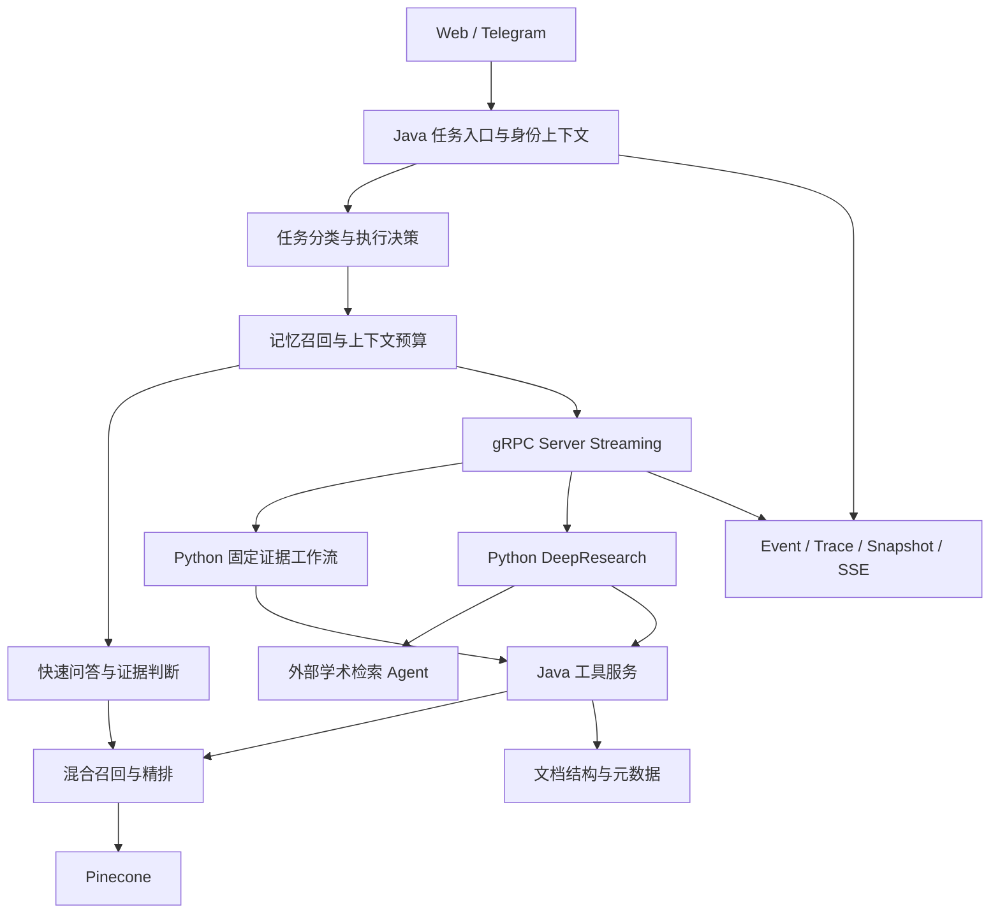

# ScholarAgent

科研文献检索、证据核验与深度研究工作台。

**Spring Boot · Python · LangGraph · gRPC · Pinecone · Redis · GROBID · Vue 3**

从论文结构解析到证据约束回答，再到按研究缺口补充检索，ScholarAgent 将科研任务组织为可观察、可追踪的执行过程。Web 工作台与 Telegram 共用任务入口、知识空间和执行服务。

## 使用场景

| 场景 | 示例 | 输出 |
| --- | --- | --- |
| 文献问答 | STRNN 如何建模空间与时间关系？ | 文献回答、证据片段与来源 |
| 论文依据核验 | GNN 能捕获 POI 转移关系，有论文依据吗？ | 观点拆解、支持度与引用 |
| 论文比较 | 比较两篇论文的时空建模方法 | 对比维度与证据 |
| 相关工作与引用 | 梳理下一地点推荐的相关工作 | 文献归纳与引用建议 |
| 深度研究 | 分析该方向的研究趋势与证据空白 | 研究计划、补充检索与研究报告 |

## 核心能力

- **结构化文献入库**：GROBID 解析标题、章节和段落，过滤参考文献，组织文档结构、片段关联与检索元数据。
- **混合检索**：Query Rewrite、Pinecone 稠密与稀疏双路召回、RRF 融合及精排，兼顾术语匹配和语义检索。
- **证据约束**：CRAG 判断证据充分性，回答关联文献片段；证据不足时补查、限定结论或拒答。
- **分级执行**：快速问答、固定证据工作流和 DeepResearch；深度研究按计划、执行、评估、重规划推进，向外部学术检索 Agent 委托补证。
- **运行可观测**：Java 控制面通过 gRPC 调用 Python LangGraph，节点事件经 SSE 更新工作台，Trace 和 Snapshot 保留执行记录。
- **上下文与资源管理**：短期上下文、语义记忆、上下文预算与工具观察压缩；Profile 限定工具、步数和资源范围。

## 架构



## 本地启动

准备 Docker Desktop、Node.js 20+、Python 3.11+ 和 PowerShell。以下命令从仓库根目录执行。

```powershell
# 下载项目级 JDK 17 与 Maven
.\setup-env.ps1

# 填入自己的模型凭据和 Pinecone 索引名称
Copy-Item scripts/local-env.example.ps1 scripts/local-env.ps1

# 构建 Web 工作台
Push-Location frontend
npm ci
npm run build
Pop-Location

# 启动基础服务、Python 运行时和 Spring Boot
.\scripts\start-local-stack.ps1
```

工作台：`http://localhost:8080/app/`。就绪检查：`http://localhost:8080/api/health/readiness`。

索引、模型、内部通信和可选 Telegram 配置见 [本地运行](docs/LOCAL_SETUP.md)。

## 代码导航

| 目录 | 内容 |
| --- | --- |
| `src/main/java/com/team/rag/agent/routing` | 任务分类、执行决策与能力目录 |
| `src/main/java/com/team/rag/agent/runtime` | 任务生命周期、Python 分发与结果处理 |
| `src/main/java/com/team/rag/service` | 文档、检索、记忆和回答服务 |
| `python-runtime/src/langgraph_runtime` | Workflow、DeepResearch、Profile 和 Checkpoint |
| `python-runtime/proto` | 跨语言通信契约 |
| `frontend/src` | Vue 工作台 |
| `src/test`、`python-runtime/tests` | 后端与运行时测试 |

## 验证入口

```powershell
.\mvnw.ps1 -q test
Push-Location python-runtime
python -m pip install -r requirements.txt -r requirements-dev.txt
$env:PYTHONPATH = "src"
python -m pytest -q
Pop-Location
```

检索、引用、任务执行和延迟的验证口径见 [评测说明](docs/EVALUATION.md)。

## 设计文档

- [架构与数据流](docs/ARCHITECTURE.md)
- [本地运行与配置](docs/LOCAL_SETUP.md)
- [评测方法与复现](docs/EVALUATION.md)

PDF 结构解析使用 GROBID，向量检索使用 Pinecone，Agent 图编排使用 LangGraph；依赖声明见 `pom.xml` 和 `python-runtime/requirements.txt`。
